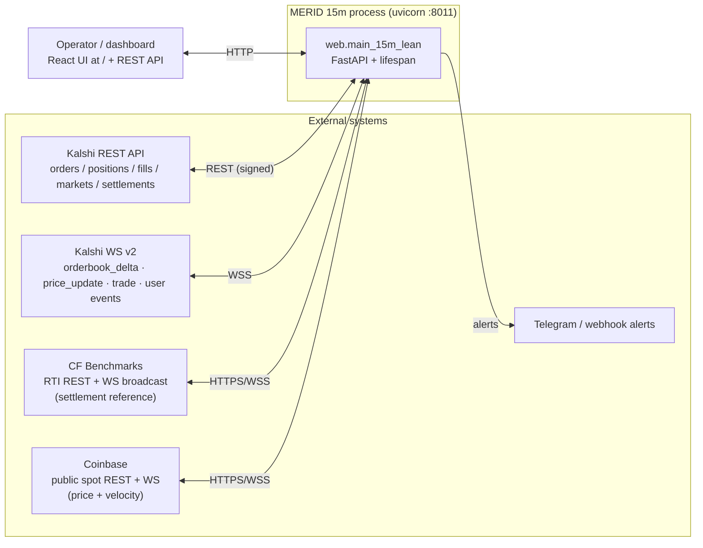
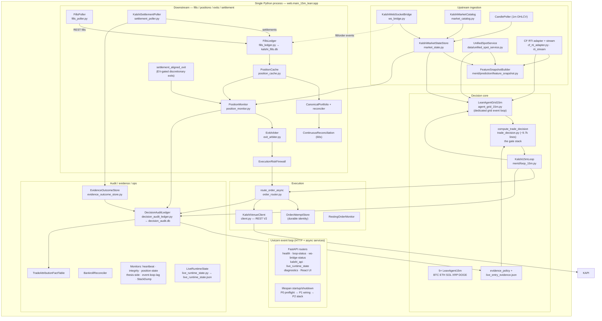
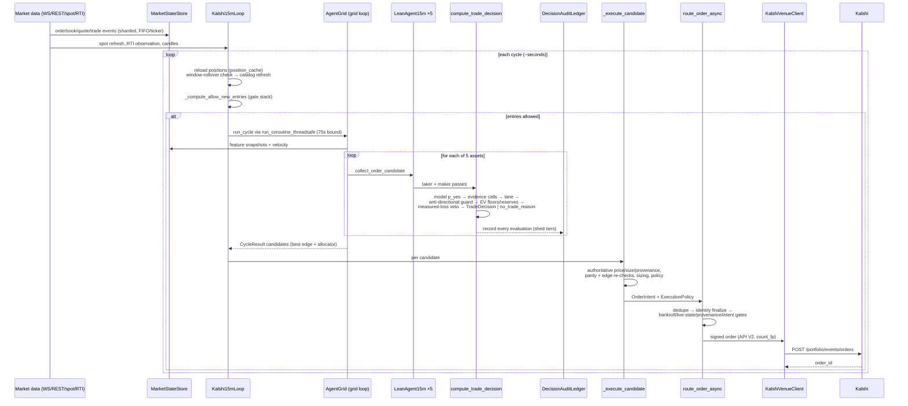
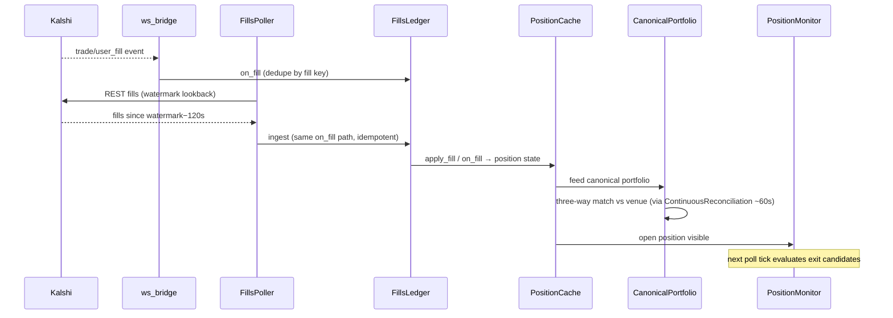
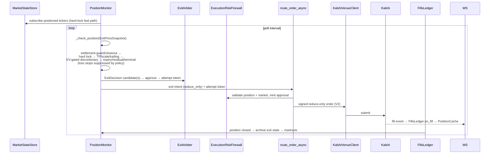
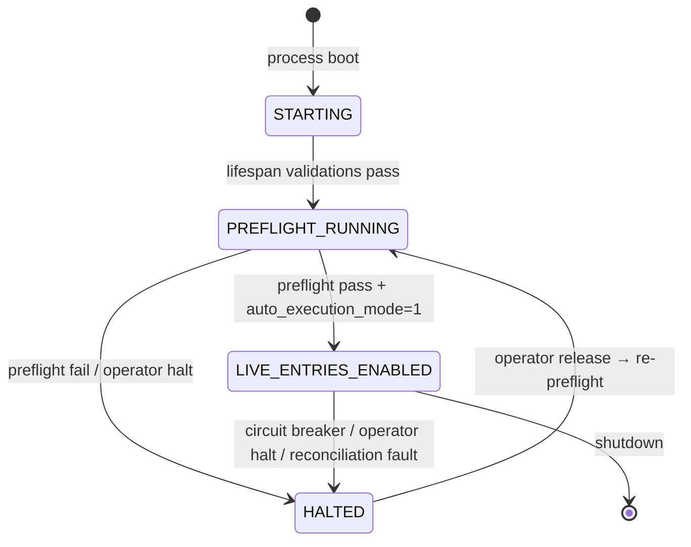
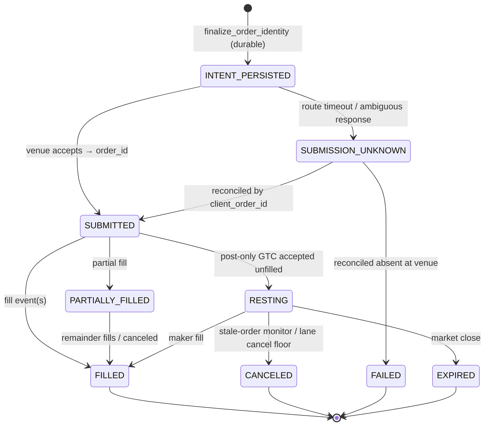
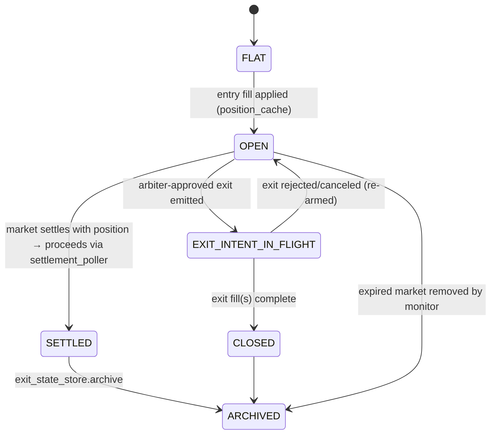

# MERID 15m Stack Map — End-to-End Architecture

**Status:** verified against code on 2026-11-18. Every component below cites its
source file. Where a claim could not be fully verified statically it is marked
`[VERIFY]`.

**Canonical production entrypoint:** `web.main_15m_lean:app`
**Launcher:** `start_15m.ps1` → uvicorn on `:8011`
**Profile:** `kalshi_crypto_15m_v2` (`MERID_PROFILE`)
**Venue:** Kalshi production (`MERID_KALSHI_ENV=prod`; launcher derives
`KALSHI_ENV=live` — see §9-D4)
**Assets:** BTC, ETH, SOL, XRP, DOGE — Kalshi 15-minute up/down markets
**Runtime contract:** `AGENTS.md` (auto-execution after preflight;
`auto_execution_mode: 1`)

This document supersedes `ARCHITECTURE_15M.md` and
`PRODUCTION_STACK_ARCHITECTURE.md` as the verified layer map. Those docs are
retained for historical rationale; discrepancies are registered in §9.

---

## 1. System context (C4 Level 1)



**Boundary rule:** the process is self-contained. All durable state lives in
SQLite DBs and JSON artifacts under `data/` (see §7). There is no message bus;
inter-component communication is in-process callbacks, asyncio queues, and
synchronous store reads.

---

## 2. Container view — what runs inside the process



**Threading model (important):** market-data forwarders, fills poller,
settlement poller, position monitor, continuous reconciliation, audit writer,
and evidence refresh each run as asyncio tasks or dedicated threads inside the
same process. The agent-grid cycle runs on a **dedicated grid event loop**
(`run_coroutine_threadsafe`, ~75s bounded timeout, poison-marked orphans) so a
hung strategy cycle cannot stall the HTTP loop — see
`merid/loop_15m.py::_run_agent_grid_with_timeout` (~line 10424).

---

## 3. Layer-by-layer

### L0 — Control plane: startup, preflight, live-state machine

| Component | Source | Role |
|---|---|---|
| Import-time guards | `web/main_15m_lean.py` (module top) | Forbidden-module scan (`merid.loop`, `merid.prediction.agent_grid`, `web.main`, legacy orchestrators), profile validation, `MERID_RUNTIME_MODE=15m_live` forced |
| Single-instance guard | `web/main_15m_lean.py` lifespan | Refuses second production process before side effects |
| Startup validations | `web/main_15m_lean.py` | `validate_production_startup`, `validate_live_trading_safety`, live latches (`TRADING_ENABLED`, `MERID_PM_PROFILE=production`, `MERID_KALSHI_WS_CLIENT=ws`) |
| Resolved config | `merid/config/live_config.py` `resolve_live_config` | Effective-config hash + build SHA stamped into diagnostics |
| P0 preflight | `merid/preflight/p0.py` | Client auth, account identity, catalog reachability, bankroll, RTI freshness, positions/orders/fills REST snapshot, shard collateral, order recovery by `client_order_id`, derived-state projection, reconciliation, exit capability |
| Live runtime state | `merid/observability/live_runtime_state.py` | `STARTING → PREFLIGHT_RUNNING → LIVE_ENTRIES_ENABLED ⇄ HALTED`; persisted `data/live_runtime_state.json`; `can_submit_live_entry()` consulted by loop **and** router; auto-enable via `MERID_AUTO_EXECUTION_MODE=1` |

**Startup order (verified):** logger reroute → single-instance guard →
validations → live latches → `resolve_live_config` → CF RTI stream early →
P0 preflight → live-runtime-state transition → catalog discovery (+ REST
fallback) → WS bridge start → bankroll init → spot service readiness →
agent-grid build/start → component health → P2 trading-stack start
(`Kalshi15mLoop.start` wires fills poller, settlement poller, position
monitor, continuous reconciliation, resting-order monitor, monitors).
Shutdown reverses: stop monitors/reconcilers → attribution + bankroll
reconciler → drain decision-audit queue → close connections → cancel tasks.

### L1 — Upstream ingestion (market & reference data)

| Feed | Source | Consumer | Freshness gate |
|---|---|---|---|
| Kalshi order book / quotes | `ws_bridge.py` (`kalshi:orderbook_delta`, `kalshi:price_update`) → `market_state.py` | grid, monitor, exits | quote age/coherence/ownership checks in `is_market_entry_ready`; orderbook events age-gated; sharded drain threads preserve per-ticker FIFO |
| Kalshi trades/fills | `ws_bridge.py` (`kalshi:trade`, user_fill) → `fills_ledger.on_fill` | positions, PnL | fill-side consistency validation; critical events never dropped under backpressure |
| Kalshi catalog | `market_catalog.py` (REST discovery + refresh thread; REST fallback in lifespan) | grid, loop | active-market presence per asset/window; rollover re-resolve |
| Spot prices | `data/unified_spot_service.py` — Coinbase public REST, TTL cache, FastAPI background refresh | grid, basis, filters | <30s freshness in entry gates; single authoritative source (hard rule in module docstring) |
| CF RTI (settlement ref) | `cf_rti_adapter.py` + `kalshi_cf_rti_ws` + RTI stream; REST fallback | `compute_trade_decision`, settlement checks | fail-closed `CfbRtiObservation`; `execution_eligible` flag; never falls back to public spot |
Candles | `CandlePoller` → 1m OHLCV into market state | features | — |
| Coinbase velocity | `event_venues/coinbase/ws_client.py` | grid cycle input | injected into `run_cycle` alongside features |
| Feature snapshots | `merid/prediction/feature_snapshot.py` | agents | aligned per-tick: RTI returns, OFI, book imbalance, spread, depth, BTC lead-lag |

**Market-state authority:** `KalshiMarketStateStore` is the single quote/book
store. Quote *ownership* (WS vs REST-derived), degraded mode, WS event age,
queue wait, and WS/REST bid-ask divergence are frozen into decision
provenance by `agent_grid_15m._call_trade_decision`.

### L2 — Decision core

| Stage | Source | What happens |
|---|---|---|
| Main loop tick | `merid/loop_15m.py` (~line 6517) | Position reload from `position_cache`; 15m-window (ET) rollover detection → catalog/market-state refresh; `_compute_allow_new_entries` gate stack (~line 5855); `_run_agent_grid_with_timeout` (~line 10424) |
| Entry gate stack | `loop_15m.py::_compute_allow_new_entries` | `KALSHI_READY` ∧ positive fresh bankroll ∧ active catalog market ∧ market state ∧ entry-ready market data (freshness/coherence/WS snapshot) ∧ healthy WS bridge ∧ queue-drain age ∧ canonical portfolio authoritative & <300s ∧ settlement-write health ∧ drawdown breaker ∧ live runtime state ∧ `observe_only=0` ∧ audit-writer health. **Exits are never blocked by this stack.** |
| Grid cycle | `agent_grid_15m.py` `run_cycle` on dedicated loop | Indicator updates; `sync_from_rest` (~30s REST position/order sync); parallel `collect_order_candidate` per asset; best-edge selection; global slot allocator; returns `CycleResult` |
| Per-asset candidate | `LeanAgent15m.collect_order_candidate` | Assembles inputs (spot, strike, book, RTI observation, candles, regime) → `_call_trade_decision` runs **taker and maker passes** → route selection (taker / maker / lane-forced) → candidate dict or typed rejection |
| Decision engine | `trade_decision.py::compute_trade_decision` | Bachelier p_yes + settlement distribution + tail calibration → evidence layer (`live_entry_evidence.json` cells, challenge mechanism, sparse tiers) → threshold/provisional cells → **lane registry** (see below) → anti-directional hold guard → regime/conviction/throttle/coinflip gates → EV floors, moneyness caps, adverse-selection/giveback/impl-shortfall/model-uncertainty/edge-bias reserves → measured-loss veto (config-scoped) → `TradeDecision` + `decision_id` or `no_trade_reason` |
| Lane registry | `trade_decision.py` `BOUNDED_POST_ONLY_LANES` (~line 791) + lane modules | Bounded lanes keep authoritative executable-price economics, 1-contract default sizing, lane-specific EV re-gates and durable caps: `cheap_tail_canary`, `evidence_cell_escape`, `threshold_cell`, `current_build_provisional`, `trend_yes_hi`, `maker_bid`, `empirical_marginal_maker`, `canary_taker`, `canary_maker`, `marginal_band`, `pinned_fav`, `late_taker_ioc`, `late_edge_probe`, plus formula lanes (`drift_fav`, `settlement_convergence`, `window_quota`, `reversal_scalp`). `cheap_no_settle` is **disabled** (`MERID_CHEAP_NO_LANE_ENABLED=0`) and de-registered from minority-hold lanes |
| Candidate execution | `loop_15m.py::_execute_candidate` (~line 11083) | Validates ticker/side/action; extracts authoritative `TradeDecision` fields (price, size, run_id, decision_id, lane); **prevents downstream price drift from replacing the EV-approved executable price**; NO-side pricing via Kalshi duality (`NO_mid = 100 − YES_mid`); canonical edge/parity checks; bounded-lane handling; builds `OrderIntent` + `ExecutionPolicy`; risk sizing (bankroll, exposure cap, slot allocator, per-trade loss budget); window policy; exit policy |
| Audit emission | `loop_15m` → `decision_audit_ledger` | Every evaluation recorded (admit + reject with `no_trade_reason`); shed tiers protect the writer |

### L3 — Order routing (the only path to the venue)

`merid/event_venues/kalshi/order_router.py` — `route_order_async` (~line
21976) → `_route_order_async_impl` (~line 20714). **There is no legacy
placement path**; tests enforce router-only submission.

Gate chain (entries and exits diverge deliberately):

1. In-flight duplicate protection (concurrent dedupe by durable identity)
2. Route timeout (~5s default) — timeout ⇒ `submission_unknown`, never blind retry
3. `finalize_order_identity` via `asyncio.to_thread` (5s bound) → durable `client_order_id`/intent identity in `OrderAttemptStore`
4. Canonical order-intent validation
5. Bankroll freshness/drawdown entry block
6. `live_runtime_state.can_submit_live_entry()` + `LIVE_ENTRIES_ENABLED` for entries; `observe_only` block
7. Decision provenance validation (decision_id/run_id/lane must match durable record)
8. **Exit branch** (`entry_or_exit=="exit"` or `reduce_only`): requires approved `ExitArbiter` attempt token (`MERID_EXIT_ARBITER_REQUIRED` default on, fail-closed) → `ExecutionRiskFirewall` re-fetches position + market, recomputes P&L, mints approval token with `approved_limit_cents`
9. Submit-time economic revalidation → persists authoritative net-EV to the durable order-attempt record
10. Venue submission via `KalshiVenueClient` (`client.py`) → signed REST, order API **V2** (`/portfolio/events/orders`); fractional `count_fp` supported
11. Post-only strict passivity / maker→taker IOC conversion rules per lane; bounded lanes keep their declared route
12. `RestingOrderMonitor` manages stale resting orders with lane-specific pre-expiry cancel floors (e.g., pinned_fav resting floor = 45s TTE)

**Idempotency:** order identity is finalized *before* submission and stored
durably; `fills_poller._reconcile_loop` resolves `submission_unknown` and
non-terminal attempts against venue order state by `client_order_id`.

### L4 — Fills and reconciliation

| Component | Source | Role |
|---|---|---|
| WS fill path | `ws_bridge.py` → `fills_ledger.on_fill` (~line 6915) → `position_cache.on_fill`/`apply_fill` | Real-time fill ingestion; fill-key dedupe makes re-delivery idempotent; side-derivation validation |
| REST fill path | `fills_poller.py` (`_poll_loop`, `_do_poll`, `_backfill_loop`) | Watermark-anchored lookback (`newest fill −120s`, clamped 15m, seeded from durable circuit-breaker watermark) — replaces the old `now−20s` window that dropped delayed fills; backfill circuit breaker; `_reconcile_loop`/`_do_reconcile` heals `submission_unknown` records and sweeps expired-market attempts |
| Fills ledger | `fills_ledger.py` → `kalshi_fills` SQLite | Canonical fill store; settlement pseudo-fills excluded from execution counts; HTTP-ingest path calls `on_fill` for position parity |
| Position cache | `position_cache.py` | Local position state; `apply_fill` (~line 1107); defers `SYNC-CLOSE`/expired removal while a non-terminal exit attempt ≤300s exists; clears `_reconciliation_halted` on verified-flat three-way match |
| Canonical portfolio | `canonical_portfolio.py` + `canonical_portfolio_reconciler.py` | Authoritative portfolio snapshot; three-way match (local ↔ ledger ↔ venue); staleness >300s blocks entries |
| Continuous reconciliation | `continuous_reconciliation.py` (~60s) | Periodic position/order/balance REST verification vs venue |

### L5 — Exits (asymmetric with entries)

Entry gates can halt *new* entries; the exit path stays live under the same
conditions by design.

| Stage | Source | Role |
|---|---|---|
| Poll loop | `position_monitor.py::_poll_loop` (~line 9029) | Per-position checks on poll interval; entry/exit markout emission; 30s-throttled stale-exit-obligation sweep (executor-offloaded); expired-market removal; market-state subscriptions kept aligned for the hard-lock fast path |
| Exit evaluation | `position_monitor.py::_check_position` (~line 4677) | Requires `ExitPriceSnapshot` (executable same-side bid from live/reconstructed book — raw ints rejected); stale-flag re-arm for post-partial residuals; **settlement guard/closeout first** (`pre_settlement_closeout_due`); then candidate set: hard profit lock, take-profit/dynamic/scale-out/trailing, EV-gated discretionary (via `settlement_aligned_exit`, mode `ev_gated`), expiry liquidation, residual-runner floor, market_terminal. Settle-hold positions forfeit the profit family |
| Loss-stop suppression | `position_monitor.py::_evaluate_stop_loss` (~line 6996) | `MERID_DISABLE_LOSS_STOPS=1` ⇒ `disabled_by_policy` (verified in `.env`); `LOSS_STOP_TRIGGER_REASONS` also suppressed at `stop_candidate` choke point and vetoed again in `order_router`. **Still live:** `POSITION_MISMATCH`, `STALE_DATA`, `OPERATIONAL_RISK`, `RECONCILIATION`, `expiry_liquidation`, manual/emergency, take-profit, settlement closeouts, EV-gated discretionary |
| Arbiter | `exit_arbiter.py` | Sole exit authority; mints approved attempt tokens consumed by the router |
| Firewall | `execution_risk_firewall.py` | Re-validates position + market at submit; P&L recompute; `approved_limit_cents` |
| Discretionary EV gate | `settlement_aligned_exit.py` | Sell-vs-hold EV comparison; `MERID_ENABLE_EV_EXIT_GATE=1`, `MERID_DISCRETIONARY_EXIT_MODE=ev_gated` |

### L6 — Settlement and proceeds

| Component | Source | Role |
|---|---|---|
| Settlement poller | `settlement_poller.py` `KalshiSettlementPoller` | Polls Kalshi settlements API; `KalshiSettlement` grading (`is_gradable`, `Outcome` YES/NO); dedupe via `SettlementDedupeKey` + persisted graded-keys file; settlement proceeds into `fills_ledger`; emits `SettlementEvent` to callbacks |
| Evidence extraction trigger | settlement → `evidence_outcome_store.extract_range` | Each settled market's evidence rows extracted **once** into `<audit>_evidence_outcomes.db` (incremental watermark pattern — see §7) |

### L7 — Audit, evidence, observability

| Component | Source | Role |
|---|---|---|
| Decision audit ledger | `decision_audit_ledger.py` → `decision_audit.db` (SQLite) | Writer thread + bounded queue; **dynamic shed tiers**: `high` never shed (side-selected decisions), `normal` shed past `MERID_AUDIT_SHED_DEPTH` (120), `low` sampled, emergency tier past `MERID_AUDIT_SHED_CRIT_DEPTH` (350) samples 1/16 of `normal`; scheduled bounded `prune_old_rows` every `MERID_AUDIT_PRUNE_INTERVAL_S` (1800s); `audit_writer_unhealthy` **gates entries** — readiness earned by draining; tables: `strategy_decisions`, `strategy_decision_snapshots`, `strategy_decision_side_ev`, `strategy_decision_outcomes`, `strategy_decision_events`, `decision_audit_gaps`, `decision_audit_heartbeats` |
| Live-entry evidence | `_refresh_live_entry_evidence` in ledger + `evidence_outcome_store.py` + `evidence_policy.py` | Rebuilds `data/live_entry_evidence.json` from the incremental outcome store (cursors `live_ts` trickle + `backfill_hi` chunks); freshness cliffs `MERID_EVIDENCE_DEGRADED_AFTER_S`/`STALE_AFTER_S`/`UNUSABLE_AFTER_S`; consumed by `compute_trade_decision` gates (hard-block `challenge` mode, sparse tiers, LCB quantile) |
| Trade attribution | `trade_attribution_fact_table.py` | Joins intent → order → fill → settlement → PnL per trade |
| Bankroll reconciler | `bankroll_reconciler.py` | Bankroll vs venue checks; drawdown breaker feeds entry gates |
| Monitors | heartbeat, integrity, position-state, thesis-side, event-loop-lag, `StackDumpTimer`/faulthandler | Liveness + forensic capture (the ~5s flat-scan spikes were attributed to audit-writer contention, not decision compute — see AGENTS.md eval-latency note) |
| Alerts | trade_notifier, tg_circuit_breaker, reconciliation_alerts, governance_notifier | Telegram/webhook |

### L8 — Operator surface

| Surface | Source | Notes |
|---|---|---|
| REST API | `web/` routers under `main_15m_lean` | `/api/v1/health` (liveness), `/ready` (readiness), `/startup`, `/unified-health`, `/loop-status`, `/ws-bridge-status`, `/md-debug`, `kalshi_api` (positions/orders/fills), `live_runtime_state_router` (halt/release), diagnostics, spot_debug, auth; OpenAPI at `/docs` |
| Dashboard | `web/react/dist` mounted at `/` | Read-mostly operator UI |
| Lifecycle log | `server_lifecycle.jsonl`, `server_console_*.log` | Written by launcher |
| Scheduled jobs | `scripts/rti_archiver.py` → `data/cf_rti_ticks.db`; `scripts/live_evidence_refresh.py` (supplementary; primary refresh is in-ledger) | External to request path |

---

## 4. Critical sequence flows

### 4.1 Startup / preflight

```mermaid
sequenceDiagram
    participant OP as Operator
    participant PS as start_15m.ps1
    participant UV as uvicorn :8011
    participant LF as lifespan (main_15m_lean)
    participant PF as P0 preflight
    participant RT as LiveRuntimeState
    participant ST as Trading stack (Kalshi15mLoop)

    OP->>PS: launch -Profile kalshi_crypto_15m_v2
    PS->>PS: MERID_KALSHI_ENV=prod → derive KALSHI_ENV=live<br/>(refuse on conflict)
    PS->>UV: spawn uvicorn web.main_15m_lean:app
    UV->>LF: import guards (forbidden modules, profile)
    LF->>LF: single-instance guard → validations → live latches
    LF->>LF: resolve_live_config → start CF RTI stream
    LF->>PF: auth, account, catalog, bankroll, RTI,<br/>positions/orders/fills snapshot, collateral,<br/>order recovery, reconciliation, exit capability
    PF-->>LF: pass / fail
    LF->>RT: PREFLIGHT_RUNNING → LIVE_ENTRIES_ENABLED<br/>(auto_execution_mode=1) or HALTED
    LF->>LF: catalog discovery → WS bridge → bankroll → spot → grid
    LF->>ST: start fills/settlement pollers, position monitor,<br/>reconciliation, resting monitor, health monitors
    ST-->>OP: /ready green; entries eligible per gate stack
```

### 4.2 Entry (happy path)



### 4.3 Fill → position → reconciliation



### 4.4 Exit



### 4.5 Settlement

```mermaid
sequenceDiagram
    participant KL as Kalshi
    participant SP as SettlementPoller
    participant FL as FillsLedger
    participant EOS as EvidenceOutcomeStore
    participant DL as DecisionAuditLedger
    participant EP as evidence_policy
    participant TD as compute_trade_decision

    SP->>KL: poll settlements API
    KL-->>SP: graded market (YES/NO, residuals)
    SP->>FL: settlement proceeds record
    SP->>EOS: extract_range → evidence_outcome_rows (once per market)
    EOS->>DL: incremental cursors (live_ts + backfill_hi)
    DL->>DL: _refresh_live_entry_evidence → live_entry_evidence.json
    EP->>EP: freshness cliffs (degraded/stale/unusable)
    TD->>EP: next cycle reads cells for gates
    Note over SP,FL: positions on expired markets archived;<br/>exchange residual handled by SettlementEvent callbacks
```

---

## 5. State machines

### 5.1 Live runtime state



`can_submit_live_entry()` is checked in **both** `loop_15m` (entry gate stack)
and `order_router` (submit gate) — defense in depth.

### 5.2 Order attempt lifecycle



Non-terminal records age out via the exit-obligation sweep and
`_sweep_expired_market_attempts`; `ORDER_NOT_TERMINAL` exit re-arms check
venue status first.

### 5.3 Position lifecycle (per market)



---

## 6. Failure-mode / gate matrix

| Layer | Gate | Source | On failure |
|---|---|---|---|
| Boot | Forbidden-module / profile guard | `main_15m_lean` import | Process refuses to start |
| Boot | Single-instance | lifespan | Second instance exits |
| Boot | P0 preflight | `preflight/p0.py` | No `LIVE_ENTRIES_ENABLED`; stays HALTED |
| Data | Quote freshness/coherence/ownership | `is_market_entry_ready` | Candidates rejected (`no_trade_reason`) |
| Data | Spot freshness <30s | entry gate stack | Entries blocked |
| Data | WS bridge health + queue-drain age | entry gate stack | Entries blocked |
| Data | Canonical portfolio authoritative <300s | entry gate stack | Entries blocked |
| Data | Settlement-write health | entry gate stack | Entries blocked |
| Data | RTI `execution_eligible` | `cf_rti_adapter` | Fail-closed; no fallback to spot |
| Decision | Evidence freshness cliffs | `evidence_policy` | Cells degrade → gates tighten/block |
| Decision | Audit-writer health | entry gate stack | Entries blocked until queue drains |
| Risk | Bankroll freshness/drawdown breaker | router + loop + `bankroll_reconciler` | Entries blocked; exits unaffected |
| Risk | Live runtime state | router + loop | Entries blocked; `HALTED` visible via API |
| Risk | `observe_only` | router | All submissions blocked |
| Exec | Durable identity + dedupe | `OrderAttemptStore` | Duplicate suppressed |
| Exec | Route timeout 5s | router | `submission_unknown` → reconcile, no retry |
| Exec | Exit arbiter token | router | Exit rejected fail-closed |
| Exec | Execution risk firewall | router | Exit rejected if position/market invalid |
| Exec | Submit-time EV revalidation | router | Persisted to attempt record; can veto |
| Downstream | Fill dedupe / side validation | `fills_ledger` | Duplicate fills ignored; mismatches flagged |
| Downstream | Reconciliation halt | `position_cache`/`canonical_portfolio` | Entries blocked until three-way match clears |
| Downstream | Loss-stop policy | `position_monitor` + `stop_candidate` + router | Loss triggers suppressed; operational exits live |
| Ops | Shed tiers + bounded prune | `decision_audit_ledger` | Writer stays live; entries gated if unhealthy |

---

## 7. Data-store inventory

| Store | Path / type | Written by | Read by |
|---|---|---|---|
| Decision audit | `decision_audit.db` (SQLite, multi-GB) | `DecisionAuditLedger` writer thread | evidence refresh, attribution, forensics |
| Evidence outcomes | `<audit>_evidence_outcomes.db` (SQLite) | `EvidenceOutcomeStore.extract_range` | `_refresh_live_entry_evidence` |
| Live evidence artifact | `data/live_entry_evidence.json` (+ `.refresh.json`) | ledger refresh | `evidence_policy` → `compute_trade_decision` |
| Fills ledger | `kalshi_fills` (SQLite) | `fills_ledger.on_fill`, settlement poller | position cache, attribution, PnL |
| RTI ticks | `data/cf_rti_ticks.db` | `scripts/rti_archiver.py` | research/forensics |
| Live runtime state | `data/live_runtime_state.json` | `live_runtime_state` | loop + router gates, API |
| Order attempts | `OrderAttemptStore` (durable) | router identity finalization | router dedupe, fills poller reconcile |
| Graded settlements | persisted graded-keys file | `settlement_poller` | dedupe across restarts |
| Exit state | `position_exit_state` store | position monitor | archive/re-arm logic |
| Config-scoped state | `data/*.json` (canary daily caps, measured-loss cells, lane budgets) | trade_decision lane modules | lane admission gates |
| Lifecycle/console logs | `server_lifecycle.jsonl`, `server_console_*.log` | launcher | operator |

---

## 8. Configuration surface (verified `.env`, 2026-11-18)

Key resolved values (env overrides code defaults):

- `MERID_PROFILE=kalshi_crypto_15m_v2`, `MERID_PM_PROFILE=production`,
  `MERID_PM_TRADING_MODE=live`, `MERID_ALLOW_LIVE_TRADES=true`,
  `MERID_KALSHI_ENV=prod` (launcher derives `KALSHI_ENV=live`)
- `MERID_AUTO_EXECUTION_MODE=1`, `MERID_OBSERVE_ONLY=0`
- `MERID_DISABLE_LOSS_STOPS=1`, `MERID_LOSS_EXITS_ENABLED=0`,
  `MERID_ENABLE_STOP_CANDIDATE_SUBMISSION=1` (operational exits only)
- `MERID_ENABLE_EV_EXIT_GATE=1`, `MERID_DISCRETIONARY_EXIT_MODE=ev_gated`
- `MERID_ENTRY_MIN_SECONDS_TO_EXPIRY=120`, `MERID_MAX_CONTRACTS_PER_ORDER=11`,
  `MERID_FIXED_EXPOSURE_CAP_USD=11.00`, `MERID_BOUNDED_LANE_MAX_CONTRACTS=11`
- `MERID_PINNED_FAV_*`: band **94–98c** (price + maker), `MAX_CONTRACTS=6`,
  EV floors `-3c` both routes, TTE split at `LATE_TTE_S=150`
  (`MID_MIN_EV_CENTS=0.0`), `MIN_TTE_S=45`, `DAILY_MAX=480`, maker `MIN_P=0.90`
- `MERID_CHEAP_NO_LANE_ENABLED=0` (+ lane de-registered from
  `MERID_MINORITY_HOLD_LANES`); anti-directional guard floors
  `P_FLOOR=0.5`, `HARD_FLOOR=0.10`
- `MERID_LATE_TAKER_LANE_ENABLED=1` scoped `ETH`/`no`/50–59.99c/TTE 120–240s,
  `IOC_CROSS=1`, daily cap 24
- Evidence: `HARD_BLOCK_MODE=challenge`, `DEGRADED/STALE/UNUSABLE` cliffs at
  48h/96h/168h, sparse tier 1 @ EV 6c, epoch ts set

---

## 9. Discrepancy register (docs ↔ code ↔ env)

| # | Finding | Status |
|---|---|---|
| D1 | `core.data_safety_integration.DataSafetyCoordinator` imported at lifespan step 7b — the **legacy `core/` package**, outside the `merid.*` production boundary. Resolved 2026-11-18: it is **not inert** — it runs hourly SQLite backups (24h/7d/4w/12mo retention) + integrity checks + retention enforcement over `kalshi_fills.db`, `analytics.db`, `alerts.db`. Effectively a production dependency living in the legacy package. | **Approved exception (documented).** Do not remove — it owns the fills-ledger backup path. Long-term: migrate `core.database_backup_manager`/`data_integrity_checker`/`data_retention_manager` under `merid/` or bless `core.*` in the boundary guard. |
| D2 | `AGENTS.md` refers to an "`apply_fill_once`" idempotent fill path. No such symbol exists; the actual path is `fills_ledger.on_fill` (dedupe by fill key) → `position_cache.on_fill`/`apply_fill`. Idempotency is real; the name is drift. | **Doc drift only** — this map uses the real symbols. No code change needed. |
| D3 | `agent_grid_15m` still loads deprecated `config/kalshi_agent_grid.yaml` for compatibility (already documented in `PRODUCTION_STACK_ARCHITECTURE.md`). | Known, documented; cosmetic — YAML is compat-only, profile yaml is authoritative. |
| D4 | `.env` sets `MERID_KALSHI_ENV=prod`, **not** `KALSHI_ENV`. `KALSHI_ENV=live` is derived by `start_15m.ps1`, which **refuses to start on conflict**. Starting uvicorn directly (bypassing the launcher) leaves `KALSHI_ENV` unset → `models.py` legacy `KALSHI_USE_DEMO` path. | Documented here; operator note: always launch via `start_15m.ps1`. |
| D5 | `ARCHITECTURE_15M.md` / `PRODUCTION_STACK_ARCHITECTURE.md` predate: `evidence_outcome_store` incremental refresh, anti-directional hold guard, lane registry growth (13+ bounded lanes), audit shed tiers/emergency sampling, pinned_fav TTE-conditioned EV floor, cheap_no de-registration, `late_taker_ioc`/`late_edge_probe` lanes. | This document supersedes them as the verified map. Recommend adding a "superseded by STACK_MAP.md" pointer to both. |
| D6 | `ws_bridge.py` module docstring lists channels `kalshi:price_update`, `kalshi:trade`, `kalshi:orderbook_delta`; subscription priority lists `fills`/`orderbooks`/`trades`. Internal naming vs wire channel names should be spot-checked against the live v2 subscription payloads if channel drift is ever suspected. | Informational `[VERIFY]` — no evidence of breakage; WS health gates would catch a dead channel. |
| D7 | Position monitor requires `ExitPriceSnapshot` (typed, provenance-carrying); `_legacy_check_position` exists for deprecated integer test paths only. | By design; noted so future edits don't reintroduce raw-price exits. |

**Verified consistent (no discrepancy):** loss-stop suppression triple-choke
(AGENTS.md ↔ `.env` ↔ code); pinned_fav 94–98/6 containment restored in `.env`;
cheap_no disabled; auto-execution contract (`auto_execution_mode:1`,
`MERID_AUTO_EXECUTION_MODE`/`MERID_OBSERVE_ONLY` consistent); entry/exit gate
asymmetry; router-only order submission enforced by tests.

---

## 10. Source index (quick reference)

- Entrypoint: `web/main_15m_lean.py` · launcher `start_15m.ps1` · profile `config/profiles/kalshi_crypto_15m_v2.yaml`
- Loop: `merid/loop_15m.py` (gate stack ~5855, grid runner ~10424, candidate exec ~11083)
- Grid/agents/decision: `merid/prediction/agent_grid_15m.py`, `merid/prediction/trade_decision.py` (lanes ~791), `merid/prediction/evidence_policy.py`, lane modules under `merid/prediction/`
- Venue: `merid/event_venues/kalshi/{client,ws_bridge,market_state,market_catalog,order_router,fills_poller,fills_ledger,position_cache,canonical_portfolio,canonical_portfolio_reconciler,continuous_reconciliation,settlement_poller,settlement_aligned_exit,execution_risk_firewall,kalshi_risk,invariants,models}.py`
- Positions/exits: `merid/position_management/{position_monitor,exit_arbiter,position_exit_state,...}.py`, `merid/risk/{crypto_rti_monitor,profiles/crypto_15m_profile}.py`
- Data: `data/unified_spot_service.py`, `merid/data/{cf_rti_adapter,kalshi_cf_rti_ws,rti_stream,feature_snapshot...}.py` (feature snapshot under `merid/prediction/`)
- Audit/evidence: `merid/execution/{decision_audit_ledger,order_decision_ledger,evidence_outcome_store}.py`, `merid/monitoring/{trade_attribution_fact_table,bankroll_reconciler}.py`
- Ops: `merid/observability/live_runtime_state.py`, monitors under `merid/monitoring/`, `merid/preflight/p0.py`, routers under `web/`

*End of stack map. Update this file whenever a layer's wiring changes; the
sequence diagrams and gate matrix are the parts most likely to drift.*
